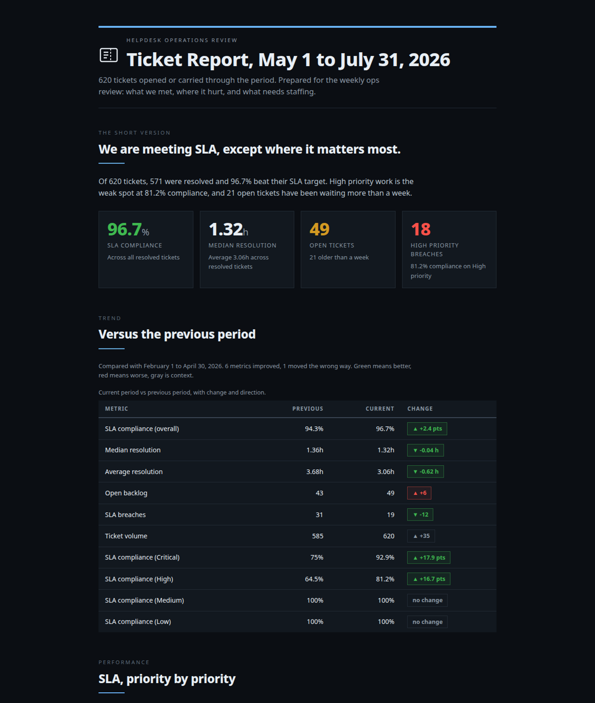

# Helpdesk Ticket Analytics

Turns a raw helpdesk ticket export (CSV) into the metrics a helpdesk lead
actually answers for: SLA compliance, resolution time, volume trends, and
backlog aging. Output is a dark ops-console HTML report with inline-SVG
charts, plus console and CSV output. Zero required dependencies.

<p align="center">
  
</p>

## The 30-second version

**In:** a CSV export of your ticket queue. **Out:** the report above.

```bash
python -m ticket_analytics.cli sample_data/tickets_sample.csv --html-out report.html
```

Open `report.html`. That is the whole workflow.

## What the metrics mean

| Metric | What it answers |
|---|---|
| SLA compliance | Share of resolved tickets closed inside their priority's target (Critical 4h / High 8h / Medium 24h / Low 72h, configurable). The number a manager asks about first. |
| Resolution time | Average and median hours from open to resolved, overall and per priority. Median resists the one 3-week ticket skewing the average. |
| Volume trends | Tickets per week, by category, by day of week, by hour of day. The staffing argument: where coverage needs to be. |
| Backlog aging | Open tickets bucketed 0-1 / 1-3 / 3-7 / 7+ days. Anything past 7 days needs an owner and a date. |
| Period comparison | `--compare prev.csv` adds a trend section: deltas on every headline metric with green/red badges for better/worse. |

## Bring your real export

Your CSV needs these columns (case-insensitive, extra columns ignored):

```
ticket_id, created_at, resolved_at, priority, category, status, assignee
```

- `resolved_at` blank means still open. `assignee` optional.
- `priority` accepts `Critical`/`High`/`Medium`/`Low` in any case, plus `P1`-`P4`, `urgent`, `normal`. Anything else is kept as-is and falls back to the Medium SLA target.
- Dates: ISO 8601 preferred, but `M/D/YYYY H:MM` style exports parse too. Timezones are normalized to UTC.
- Encoding: UTF-8 (with or without BOM) or Windows cp1252. Blank rows are skipped. A row the loader cannot parse stops the run with the file and line number, so you can fix the export instead of silently losing tickets.

Exporting a ServiceNow/Remedy queue to CSV with those columns (or renaming a couple of headers) is normally all it takes.

## Commands

```bash
# Console report only
python -m ticket_analytics.cli tickets.csv

# Full HTML report with charts + CSV summary
python -m ticket_analytics.cli tickets.csv --html-out report.html --csv-out summary.csv

# Compare against the previous period (adds trend deltas to console + HTML)
python -m ticket_analytics.cli tickets_q2.csv --compare tickets_q1.csv --html-out report.html

# One-click PDF (needs Chromium/Chrome on PATH, or set CHROMIUM_BIN; no new dependencies)
python -m ticket_analytics.cli tickets.csv --pdf-out report.pdf

# Override default SLA targets
echo '{"Critical": 2, "High": 6}' > custom_sla.json
python -m ticket_analytics.cli tickets.csv --sla-config custom_sla.json
```

## Sample data

`sample_data/tickets_sample.csv` is 620 fully synthetic tickets generated by
`scripts/generate_sample_data.py` (May 1 to July 31, 2026): weighted toward
weekday/business-hours volume with a deliberate tail of SLA breaches, so the
report is not a meaningless 100% across the board. `sample_data/tickets_prev_period.csv`
is 585 synthetic tickets for Feb 1 to Apr 30, 2026 (via `scripts/generate_prev_period.py`)
with a worse breach rate, so `--compare` shows real deltas. No real ticket
data is included or required; validate against your own export before
trusting the numbers for decisions.

## Project layout

```
ticket_analytics/
  models.py     Ticket dataclass + default SLA targets
  loader.py     CSV -> Ticket loader (encoding/date/priority tolerant, line-numbered errors)
  metrics.py    all metric computation (pure functions, no I/O)
  compare.py    period-over-period deltas with good/bad/neutral sentiment
  charts.py     tiny dependency-free inline-SVG bar chart renderer
  report.py     console, HTML, CSV, and PDF report output
  cli.py        entry point
sample_data/    synthetic sample exports (current + previous period)
scripts/        sample data generators
tests/          pytest suite (31 tests)
```

## Testing

```bash
pip install -r requirements.txt
pytest -q
```

31 tests: the loader (column validation, sorting, case-insensitive headers,
US date formats, cp1252, priority aliases, malformed-row line numbers), the
metrics engine (averages/medians, SLA breach detection, category ranking,
backlog-aging bucketing, day-of-week/hour breakdowns), and the comparison
math (delta direction, good/bad/neutral sentiment, per-priority deltas).

## Design notes

- **Zero required dependencies.** The metrics engine and CLI run on stdlib
  alone; charts are hand-rolled SVG rather than pulling in matplotlib. PDF
  export shells out to a Chromium you already have instead of adding a
  binary dependency.
- **`metrics.py` has no I/O.** `compute_metrics()` takes a list of `Ticket`
  objects and returns a plain dataclass, so it is trivially unit-testable
  and does not care whether the tickets came from a CSV, a database query,
  or a test fixture.
- **The loader is strict about data loss, lenient about format.** It tries
  hard to parse messy real-world exports, but a row it cannot parse fails
  loudly with a line number rather than being silently dropped.

## License

MIT - see [LICENSE](LICENSE).

---

*Built by [Hans Sai](https://builtbysai.com).*
