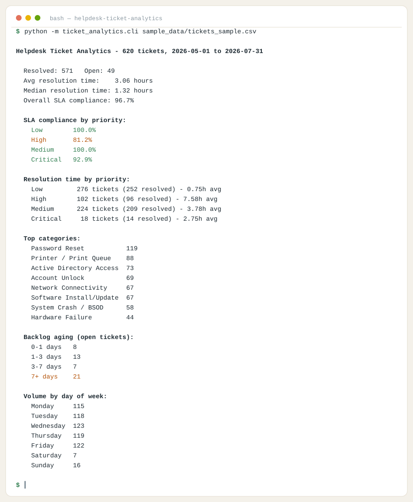
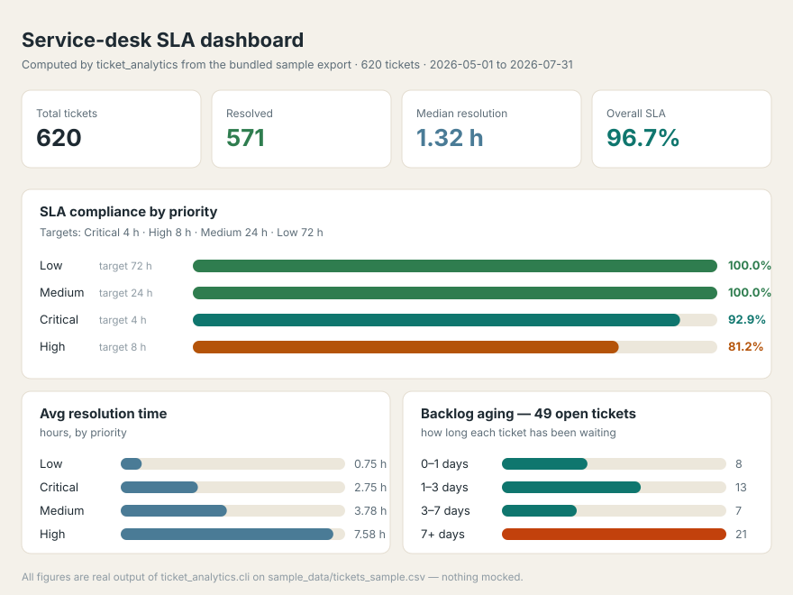

# Helpdesk Ticket Analytics

A dependency-free Python tool that turns a raw helpdesk ticket export (CSV)
into the metrics a helpdesk lead actually needs: SLA compliance, resolution
time by priority and category, ticket volume trends, and open-ticket
backlog aging - plus an HTML report with charts, no matplotlib required.

Built to mirror real high-volume ticket queue work (12-15 tickets/day,
1,000+/year across Level 2 support) - this is the reporting layer that
turns "I resolved a lot of tickets" into a number a manager can act on.

Run the quick start below and open `report.html` to see the full breakdown -
SLA compliance by priority, backlog aging buckets, and a weekly volume trend,
all rendered with inline SVG charts (no matplotlib dependency).

<p align="center">
  
</p>
<p align="center">
  
</p>

## What it computes

- **Volume**: total, by category, by priority, by day of week, by hour of day (useful for staffing conversations)
- **Resolution time**: average and median, overall and broken out by priority
- **SLA compliance**: percentage of resolved tickets that beat their priority's SLA target (configurable - defaults are Critical 4h / High 8h / Medium 24h / Low 72h, a fairly standard ITSM configuration), overall and per priority
- **Backlog aging**: open tickets bucketed by how long they've been open (0-1 / 1-3 / 3-7 / 7+ days)
- **Weekly trend**: ticket count per ISO week

## Quick start

```bash
# Console report only
python -m ticket_analytics.cli sample_data/tickets_sample.csv

# Full HTML report with charts + CSV summary
python -m ticket_analytics.cli sample_data/tickets_sample.csv \
    --html-out report.html --csv-out summary.csv

# Override default SLA targets
echo '{"Critical": 2, "High": 6}' > custom_sla.json
python -m ticket_analytics.cli sample_data/tickets_sample.csv --sla-config custom_sla.json
```

`sample_data/tickets_sample.csv` is 620 fully synthetic tickets generated by
`scripts/generate_sample_data.py` - weighted toward weekday/business-hours
volume and with a deliberate tail of SLA breaches, so the report isn't a
meaningless 100% across the board. No real ticket data is included or
required.

## Bring your own export

Any CSV with these columns works (case-insensitive, extra columns ignored):

```
ticket_id, created_at, resolved_at, priority, category, status, assignee
```

`resolved_at` can be blank for still-open tickets. `priority` should be one
of `Critical`, `High`, `Medium`, `Low` (or pass `--sla-config` to remap).
Exporting a ServiceNow/Remedy queue to CSV with those columns (or renaming
a couple of headers) is normally all it takes.

## Project layout

```
ticket_analytics/
  models.py     Ticket dataclass + default SLA targets
  loader.py     CSV -> Ticket loader with column validation
  metrics.py    all metric computation (pure functions, no I/O)
  charts.py     tiny dependency-free inline-SVG bar chart renderer
  report.py     console, HTML, and CSV report output
  cli.py        entry point
sample_data/    synthetic 620-ticket sample export
scripts/generate_sample_data.py   regenerates the sample data
tests/          pytest suite (14 tests)
```

## Testing

```bash
pip install -r requirements.txt
pytest -q
```

14 tests covering the loader (column validation, sorting, case-insensitive
headers) and the metrics engine (averages/medians, SLA breach detection
against both default and custom configs, category ranking, backlog-aging
bucketing, day-of-week/hour breakdowns).

## Design notes

- **Zero required dependencies.** The metrics engine and CLI run on stdlib
  alone; charts are hand-rolled SVG rather than pulling in matplotlib, so
  the tool works anywhere Python 3.10+ runs.
- **`metrics.py` has no I/O.** `compute_metrics()` takes a list of `Ticket`
  objects and returns a plain dataclass - it's trivially unit-testable and
  doesn't care whether the tickets came from a CSV, a database query, or a
  test fixture.
- **SLA logic is configurable, not hardcoded**, because every organization's
  targets differ - `--sla-config` overrides any subset of the defaults.

## License

MIT - see [LICENSE](LICENSE).

---

*Built by [Hans Sai](https://builtbysai.com).*
